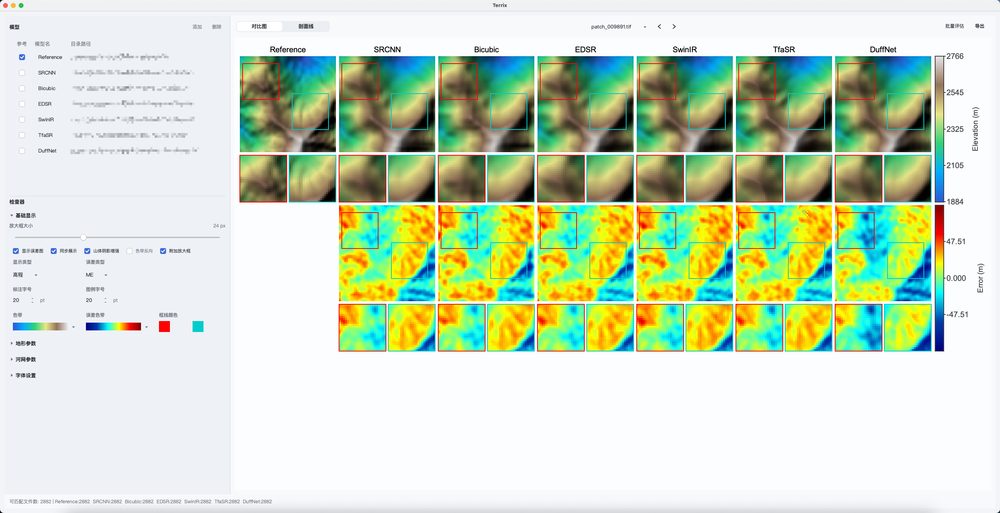

# Terrix

Terrix is a desktop tool designed for DEM result comparison and visual analysis. It is suitable for comparing terrain raster outputs generated by multiple models. Terrix can automatically align tif/tiff samples with the same file names and supports side-by-side preview, local zooming, slope and aspect derived analysis, error map visualization, terrain profile plotting, accuracy metric calculation, and high-resolution figure export, including vector PDF output.

## Core Features

### Multi-model DEM Comparison

- Supports importing multiple model result directories at the same time
- Supports setting reference data
- Automatically matches tif/tiff samples with the same file names across different model directories
- Supports model order adjustment, path modification, and list management

### Multiple Terrain Visualization Modes

- Elevation visualization
- Slope visualization
- Aspect visualization
- Color ramp switching
- Error map display
- DEM profile display

### Local Zooming and Synchronized Observation

- Supports dragging a zoom box in the overview map
- Automatically displays the corresponding local region below
- Uses the same zoom location for all models, making it convenient to compare local details across models

### Hillshade Enhancement

- Computes hillshade separately for each model based on its own DEM
- Does not simply overlay hillshade with transparency. Instead, it performs illumination blending between the pseudo-color DEM and the hillshade result合
- More suitable for observing terrain relief, texture, and micro-geomorphic structures

### River Network Overlay Analysis

- Supports extracting river networks from DEM results and overlaying them on the visualization
- Supports adjustment of flow accumulation threshold, river line width, point size, color, and other parameters
- Supports depression filling options

### Accuracy Assessment

Terrix includes a unified accuracy assessment module, which supports batch calculation and result export for each sample.

Supported metrics:

- `mIoU`
- `PSNR`
- `SSIM`
- `RMSE`
- `MAE`
- `ME`

Supported assessment targets:

- Elevation
- Slope
- Aspect

Specifically:

- `mIoU` is always calculated based on DEM-derived river network extraction results
- The other five metrics are calculated based on the currently selected elevation, slope, or aspect result
- Aspect assessment supports an option for considering circular error, where 0° is equivalent to 360°
- SSIM supports sliding window configuration

Exported results include:

- One image-level CSV file for each metric
- One summary CSV file
- The summary results include the mean value and 95% confidence interval for each model

### High-resolution Export

- Supports exporting the current comparison figure
- Supports `png / jpg / pdf / tif`
- Supports custom export DPI
- Suitable for paper figures, report figures, and result presentation

## Workflow

1. Import multiple model directories and specify the reference model
2. Select samples with the same file names for comparison 
3. Switch between elevation, slope, and aspect visualization
4. Use the zoom box to inspect local details  
5. Overlay river networks, enable error maps, or apply hillshade enhancement as needed  
6. Export the current figure, or perform batch accuracy assessment and export CSV files

## Use Cases

- DEM super-resolution result comparison
- Visual inspection of terrain reconstruction experiments
- Side-by-side comparison of multi-model inference results
- River network restoration analysis
- Rapid generation of figures for papers and presentations

## Platform and Runtime

The current project is mainly designed for the Mac desktop environment. The core implementation is based on Java 17 and Swing.
